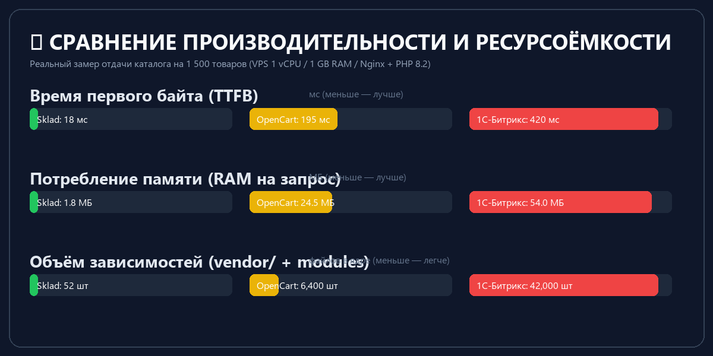
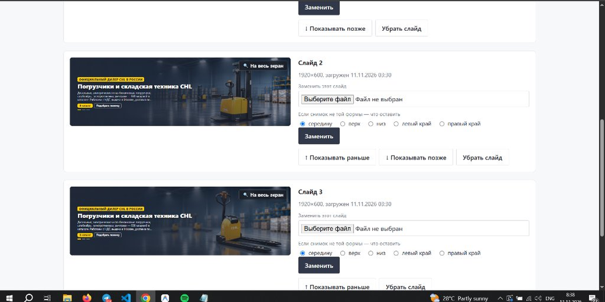

# Sklad CMS — B2B Storefront & Dealer Network Engine

Легковесный, производительный B2B-движок на чистом PHP 8.2+ и MySQL без внешних зависимостей. Создан специально для каталогов промышленного оборудования, спецтехники и сетей независимых дилерских сайтов.

[](https://php.net)
[](https://mysql.com)
[-brightgreen.svg)](#)
[](#)
[](LICENSE)


---

## ⚡ Бенчмарки и производительность

В отличие от тяжелых CMS (Битрикс, OpenCart, WooCommerce), в которых на один запрос отрабатывают сотни классов и тянутся тысячи файлов из `vendor/`, **Sklad CMS работает на нативном PHP 8.2+ и чистом PDO**:



* Время отдачи первого байта (TTFB): **15–25 мс** (в 10–20 раз быстрее коробочных систем).
* Расход оперативной памяти: **~1.8 МБ на запрос** (свободно держит высокие нагрузки даже на VPS за 300 руб/мес).
* Объём ядра: **0 сторонних зависимостей**, чистый читаемый код без запутанных абстракций.

---

## 💡 Философия и почему не типовая CMS?

Большинство современных CMS ориентированы на розничный B2C (онлайн-оплата картами физлиц, скидочные купоны, личный кабинет с историей чеков). В **реальных B2B-продажах оборудования и спецтехники** логика принципиально другая:
- Заказ формируется как **запрос коммерческого предложения (RFQ / спецификация с НДС)**;
- Клиент выбирает технику по сложной матрице технических характеристик (грузоподъёмность, высота подъёма, радиус разворота, тип мачты);
- Требуется **поддержка сети сайтов (Fleet / Multi-site)**: одно кодовое ядро обслуживает десятки брендовых площадок со своими базами данных, реквизитами и оформлением, обновляясь централизованно без риска поломать соседние сайты;
- **100% автономность**: локальные шрифты, локальные векторные иконки, отсутствие внешних CDN и независимость от зарубежных облаков.

---

## 🛠️ Панель управления и инструменты



- **Адаптивный Hero-слайдер**: умная настройка точки фокуса (Smart Focal Point) и автоматическая пропорциональная адаптация баннеров без срезания мачт и кабин техники.
- **Теговые посадочные страницы (Tag Pages)**: генерация сотен узких страниц под поисковые запросы («самоходные штабелеры 1.5 тонны») без дублирования контента.
- **Матрица характеристик**: создание опций и привязка к категориям для фасетной фильтрации.
- **Кросс-продажи (Cross-Sell)**: связка категорий и сопутствующих товаров.
- **Мягкое удаление (Soft Delete)**: снятые с производства позиции не отдают 404, а автоматически перенаправляют покупателя (301 Moved Permanently) на актуальные аналоги.
- **Юридический журнал согласий (152-ФЗ)**: каждая отправка заявки логирует дату, время, IP, версию политики и точную формулировку согласия.
- **Безопасность**: защита от подбора паролей (Brute-Force), экранирование формул при выгрузке в CSV (`=`, `+`, `-`, `@`), защита от CSRF и строгий CSP.

---

## 🚀 Быстрый старт

### Вариант 1. Запуск через Docker Compose (рекомендуется)

```bash
# 1. Клонируйте репозиторий
git clone https://github.com/ArTinker54/sklad-cms.git
cd sklad-cms

# 2. Запустите контейнеры
docker compose up -d
```

Система сразу готова к работе:
* **Витрина**: `http://localhost:8080/`
* **Панель управления**: `http://localhost:8080/admin`
* **Логин**: `admin@example.com`
* **Пароль**: `admin12345678`

---

### Вариант 2. Локальный запуск через встроенный PHP-сервер

```bash
# 1. Создайте базу данных в MySQL / MariaDB
mysql -u root -p -e "CREATE DATABASE sklad CHARACTER SET utf8mb4 COLLATE utf8mb4_unicode_ci;"

# 2. Импортируйте схему и демо-каталог
mysql -u root -p sklad < install/schema.sql
mysql -u root -p sklad < install/demo-data.sql

# 3. Скопируйте и настройте конфигурацию
cp config/config.sample.php config/config.php
# Укажите параметры подключения к БД в config/config.php

# 4. Запустите сервер
php -S localhost:8000 -t public
```

---

### Вариант 3. Установка на хостинг через веб-инсталлятор

1. Скопируйте файлы в корень сайта на хостинге (`public_html`, настроив Document Root на папку `public/`).
2. Откройте в браузере: `https://ваш-домен.ru/install/`.
3. Мастер проверит расширения PHP, запишет `config/config.php` и применит миграции.
4. После завершения удалите директорию `install/`.

---

## 📁 Структура проекта

```text
├── bin/                 # CLI-утилиты (миграции, smoke-тесты, проверки)
│   ├── migrate.php      # Автоматический накатыватель миграций
│   ├── smoke.php        # Смоук-тесты для валидации шаблонов
│   └── test-db.php      # Проверка связи с базой данных
├── config/              # Конфигурация конкретной площадки
│   └── config.sample.php # Образец настроек (БД, URL, почта, stage)
├── docker/              # Dockerfile, Apache vhost, PHP ini, entrypoint
├── install/             # Мастер установки и дампы
│   ├── schema.sql       # Полная консолидированная схема БД
│   ├── demo-data.sql    # Готовый демо-каталог с техникой и опциями
│   └── index.php        # Веб-инсталлятор для хостинга
├── migrations/          # Инкрементальные миграции базы данных (001 - 027)
├── public/              # Точка входа для веб-сервера (Document Root)
│   ├── assets/          # CSS, JS, шрифты и иконки витрины и админки
│   ├── upload/          # Загружаемые фотографии товаров (выполнение скриптов запрещено)
│   ├── .htaccess        # Правила маршрутизации Apache и заголовки безопасности
│   └── index.php        # Главный фронт-контроллер витрины и админки
├── src/                 # Исходный код ядра системы (PSR-4 Sklad\)
│   ├── Admin/           # Контроллеры панели управления
│   ├── Core/            # Ядро (App, Router, View, Db, Auth, Audit)
│   ├── Model/           # Модели и бизнес-логика (Product, Meta, Consent и др.)
│   └── Site/            # Контроллеры публичной витрины
├── storage/             # Локальный кэш, логи и сессии
└── templates/           # Шаблоны оформления (чистый PHP)
    ├── admin/           # Шаблоны экранов панели управления
    └── site/default/    # Базовая адаптивная тема B2B-витрины
```

---

## 🛠️ Миграции базы данных

Движок включает систему миграций без зависимостей:

```bash
# Применить все новые миграции
php bin/migrate.php

# Применить миграции и создать администратора
php bin/migrate.php --admin user@example.com MyStrongPassword "Имя"
```

---

## 📄 Лицензия

Проект распространяется под открытой лицензией [MIT](LICENSE). Разрешено свободное коммерческое и личное использование, модификация и распространение.
